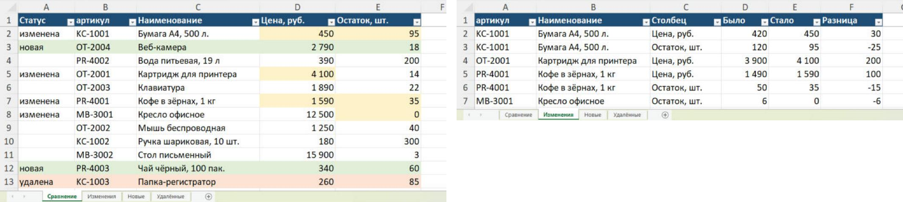
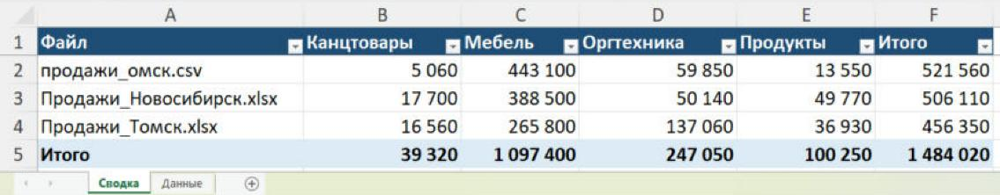
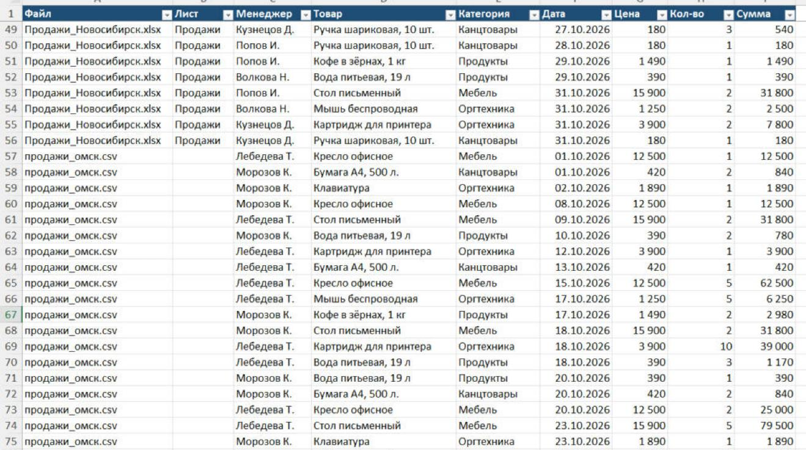

# Excel Tools — рутина с таблицами одной командой

[](https://github.com/SHUHER322/excel_tools/actions/workflows/tests.yml)

Скрипты на Python для типичных задач с Excel и CSV, на которые вручную уходят часы:
собрать выгрузки филиалов в одну таблицу, почистить их, сделать сводный отчёт, сравнить
два прайса и разослать каждому менеджеру его часть. Результат — аккуратный Excel, которым
можно сразу пользоваться.

**Стек:** Python 3.14, pandas, openpyxl, pytest + GitHub Actions.

## Как это выглядит

**Сравнение двух прайсов** — изменения подсвечены, на отдельных листах: что изменилось
(было → стало), что добавилось и что пропало:



<table>
  <tr>
    <th>Сводный отчёт по филиалам и категориям</th>
    <th>Три выгрузки, собранные в одну таблицу</th>
  </tr>
  <tr>
    <td></td>
    <td></td>
  </tr>
</table>

## Что умеет

| Команда | Что делает |
|---|---|
| `merge` | Объединяет файлы, папки и все листы в одну таблицу. Столбцы сопоставляются по названию: «ТОВАР», « товар » и «Товар» — один столбец, даже если в файлах они стоят в разном порядке. Видно, из какого файла и листа каждая строка |
| `clean` | Чистит таблицу: лишние пробелы, пустые строки, повторы, числа и даты, записанные текстом |
| `summary` | Сводный отчёт: итоги по менеджерам, категориям, месяцам или неделям, перекрёстная таблица |
| `compare` | Сравнивает две версии таблицы по ключу (артикулу, коду): изменения, новые и удалённые строки |
| `split` | Разбивает таблицу по значению столбца: каждому менеджеру или филиалу свой файл или лист |

**Справляется с «живыми» файлами**
- Шапка не в первой строке (сверху название отчёта) — находится сама
- CSV из 1С и других программ: Windows-1251 или UTF-8, разделитель `;`, `,` или табуляция
- Числа текстом «12 500,00 ₽» и даты «05.10.2026» становятся настоящими числами и датами;
  артикулы вроде «00123» остаются как есть, а непонятные значения («нет») не теряются
- «Сумма, руб.» и «Сумма» считаются одним столбцом

**Результат — готовый Excel**
- Шапка выделена и закреплена, включены фильтры, ширина столбцов по содержимому
- Числа и даты — числа и даты Excel: работают сортировка и формулы
- Если прошлый результат открыт в Excel, новый сохраняется рядом, а не теряется

## Запуск

```bash
python -m venv .venv                   # Windows: py -V:3.14 -m venv .venv
source .venv/bin/activate              # Windows: .venv\Scripts\activate
pip install -r requirements.txt
```

Примеры ниже работают на демо-данных из папки `examples` (все данные выдуманы).
Результаты сохраняются в папку `output`.

**Собрать выгрузки трёх филиалов в одну таблицу и почистить:**

```
$ python -m exceltools merge examples/data --clean
Таблиц: 4
  Продажи_Новосибирск.xlsx [Продажи]: 58 строк
  продажи_омск.csv: 30 строк
  Продажи_Томск.xlsx [Октябрь]: 45 строк
  Продажи_Томск.xlsx [Возвраты]: 4 строк
Итого строк: 137
Очистка:
  Строк: было 137, стало 134
  Удалено повторов: 3
  Убраны лишние пробелы в ячейках: 15
Готово: output/объединено.xlsx
```

**Сводный отчёт:**

```bash
python -m exceltools summary examples/data --by Менеджер --values Сумма
python -m exceltools summary examples/data --by Дата:неделя --values Сумма
python -m exceltools summary examples/data --by Файл --pivot Категория --values Сумма
```

**Сравнить два прайса:**

```
$ python -m exceltools compare examples/compare/Прайс_сентябрь.xlsx examples/compare/Прайс_октябрь.xlsx --key Артикул
Изменено строк: 4 (ячеек: 6)
Новых строк: 2
Удалённых строк: 1
Готово: output/сравнение.xlsx
```

**Свой файл каждому менеджеру:**

```bash
python -m exceltools split examples/data --by Менеджер            # папка с файлами
python -m exceltools split examples/data --by Менеджер --sheets   # одна книга, лист на менеджера
```

У каждой команды есть справка: `python -m exceltools summary --help`.

Тесты: `pip install -r requirements-dev.txt && pytest`

## Как устроено

```
exceltools/
  tables.py     — чтение xlsx и csv: поиск шапки, кодировка, разделитель
  values.py     — числа и даты, записанные текстом; сопоставление названий столбцов
  clean.py      — очистка
  merge.py      — объединение
  summary.py    — сводный отчёт
  compare.py    — сравнение по ключу
  split.py      — разбивка
  excel.py      — запись оформленного Excel
examples/
  make_demo.py  — генератор демо-данных
```

Логика — обычные функции над таблицами pandas, поэтому всё проверяется тестами
без Excel: 69 тестов, автозапуск в GitHub Actions.

## Под задачу заказчика

Это основа: под конкретную задачу добавляется своя логика — расчёт премий по продажам,
сверка с выпиской банка, отчёт в фирменном шаблоне, запуск двойным щелчком без
командной строки, отправка результатов на почту или в Telegram.
